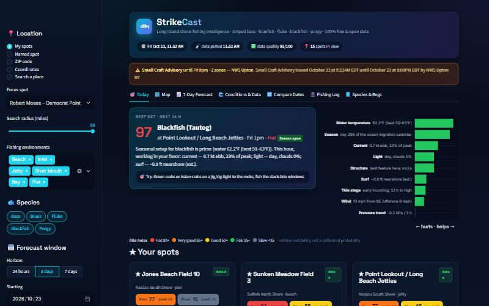
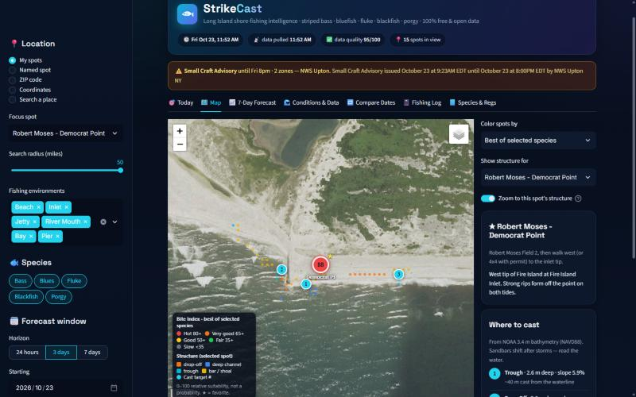
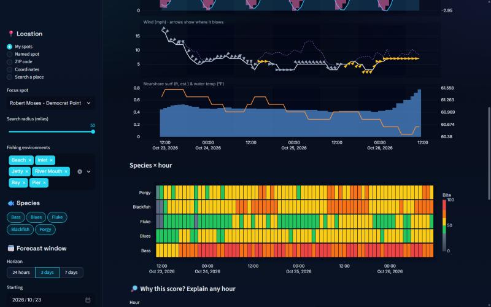
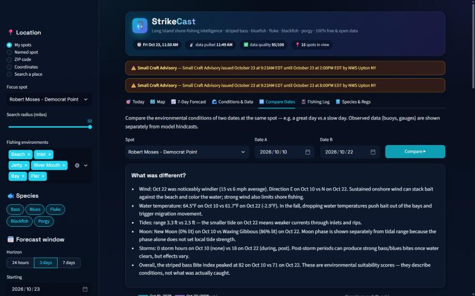
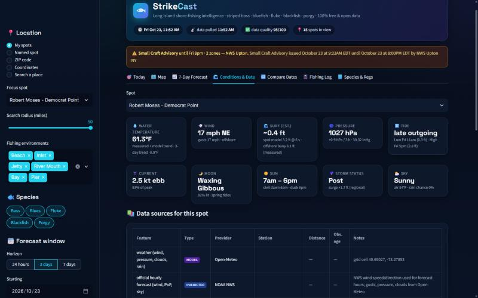

# 🎣 StrikeCast

**Free, open-data fishing intelligence for Long Island shore anglers.**
StrikeCast pulls live NOAA tides, currents, buoys, weather, alerts and high-resolution bathymetry, then tells you
**where and when** to fish for **striped bass, bluefish, fluke, blackfish (tautog) and porgy (scup)** — and *why*.

No API keys. No subscriptions. Every data source is free and public.



---

## What it does

| | |
|---|---|
| 🎯 **Best bet right now** | Scans every spot and species for the next 24 h and explains the top pick in plain English, with a lure/bait suggestion. |
| ★ **Your spots, always on screen** | Jones Beach Field 10 · Sunken Meadow Field 3 · Point Lookout / Long Beach jetties · Jones Beach Field 2 · Robert Moses – Democrat Point (plus 12 more LI spots). |
| 🗺️ **Map with legend** | Spots colored by Bite Index. Satellite, NOAA nautical chart, OpenSeaMap and ocean-depth layers. Zoom into a spot to see **drop-offs, troughs, channels, bars and numbered cast targets** computed from NOAA's ~3 m bathymetry. |
| 📈 **7-day hourly forecast** | Bite Index per species, tide curve + official current predictions, wind with direction arrows, surf and water temperature, night shading and highlighted best windows. |
| 🔎 **Explain any hour** | Factor-by-factor breakdown (current, tide stage, light, wind, surf, pressure trend, bait, season, water temp…). |
| 🌊 **Conditions & provenance** | Every number labeled *measured / predicted / model / interpolated / heuristic*, with station, distance and data age. Missing data is shown, never invented. |
| 🔁 **Compare two dates** | e.g. Oct 10 vs Oct 22, 2026 at Democrat Point — side-by-side charts, a metric table, and a summary of what was different. |
| 📓 **Fishing log + learning** | Log trips (including skunks). Each log entry saves a snapshot of the conditions at that time. After ~20 trips, StrikeCast trains a personal model with a chronological train/test split. CSV import/export. |
| ⚠️ **NWS alerts** | Small Craft Advisories, Gale Warnings, Coastal Flood statements for your spots. |
| 📘 **Species & regs** | Season open/closed today, size and bag (NY, verify with DEC), best water temps, tactics, seasonal migration curves. |
| 🔌 **REST API** | FastAPI service for a future mobile/React frontend, with an hourly background refresh of your favorites. |

<p float="left">
  
  
</p>
<p float="left">
  
  
</p>

---

## Quick start

**Requirements:** Python 3.12+ and internet access. Packages install into a local `.venv` folder inside the project (nothing is installed system-wide).

### Windows (double-click)
1. Download or clone the repo.
2. Double-click **`install.bat`**: it creates a local `.venv` and installs every package (listed in the file).
3. Double-click **`start.bat`**: the dashboard opens in your browser. Close the window to stop it.

`start.bat` runs the installer automatically if it hasn't been run yet. PowerShell users can also use `.\run.ps1`
(`.\run.ps1 api` for the REST API, `.\run.ps1 test` for tests).

### macOS / Linux
```bash
git clone https://github.com/<you>/strikecast.git
cd strikecast
chmod +x run.sh && ./run.sh
```

Then open **http://localhost:8501**. The first load pulls ~70 datasets (a progress bar shows each one) and takes 10–30 s; after that, responses are cached locally according to how often each provider updates.

### Manual setup
```bash
python -m venv .venv
.venv/Scripts/activate            # Windows   (macOS/Linux: source .venv/bin/activate)
pip install -r requirements.txt
streamlit run dashboard/streamlit_app.py      # dashboard
uvicorn app.main:app --port 8000              # REST API  -> http://127.0.0.1:8000/docs
pytest -q                                     # tests
```

### Configuration
Copy `.env.example` to `.env` (optional). Please set `STRIKECAST_CONTACT` to your GitHub URL or email: NOAA/NWS and
OpenStreetMap ask API users to identify themselves.

---

## Free data sources

| Data | Provider | Type | Notes |
|---|---|---|---|
| Tide highs/lows | [NOAA CO-OPS](https://api.tidesandcurrents.noaa.gov/api/prod/) | predicted | Station chosen per spot (e.g. Democrat Point 8515228) |
| Tidal currents (max flood/ebb, slack) | NOAA CO-OPS current predictions | predicted | Fire Island Inlet, Jones Inlet, Crane Neck, Shinnecock… |
| Water temperature, water level | NOAA CO-OPS gauges, [NOAA NDBC](https://www.ndbc.noaa.gov/) buoys 44025 / 44065 / 44069 | measured | Freshest suitable station is used; any substitution is shown |
| Offshore waves | NOAA NDBC | measured | Kept separate from the nearshore surf estimate |
| Hourly forecast, alerts | [NOAA / National Weather Service API](https://www.weather.gov/documentation/services-web-api) | predicted | Official wind; Small Craft / Gale / Coastal Flood alerts |
| Weather (pressure, gusts, clouds, rain) | [Open-Meteo](https://open-meteo.com) (CC BY 4.0) | model | Also historical archive for date comparisons |
| Waves, swell, SST | [Open-Meteo Marine](https://open-meteo.com/en/docs/marine-weather-api) | model | |
| Bathymetry (~3 m) | [NOAA NCEI CUDEM](https://www.ncei.noaa.gov/products/coastal-elevation-models) via DEM ImageServer | measured (survey) | Drop-offs, troughs, channels, cast targets |
| Nautical chart | NOAA Office of Coast Survey ENC (WMS) | — | Map overlay |
| Imagery / basemaps | USGS National Map (public domain), Esri, OpenStreetMap, CARTO, OpenSeaMap | — | Map layers |
| Geocoding | Zippopotam.us (ZIP), OSM Nominatim (places) | — | |
| Sun & moon | PyEphem (computed locally) | computed | Sunrise/set, twilight, moonrise/set/transit, phase |

---

## How the scores work

StrikeCast follows a **transparent, configurable, rule-based** approach (see [`configs/species.yaml`](configs/species.yaml)):

1. **Baitfish Habitat Suitability Index (0–100)** — separate profiles for adult bunker, peanut bunker, sand eels, bay
   anchovies and silversides. Each responds differently to season, water temperature, habitat, onshore wind duration,
   tide direction and sea state.
2. **Species Habitat Index ("presence", 0–100)** — season (a location-specific migration curve adjusted for latitude and
   water body) × water temperature, then refined by shoreline structure (spot tags + bathymetry) and preferred bait.
3. **Feeding Activity Index (0–100, hourly)** — tidal current strength vs the species' preference (from NOAA current
   predictions — max current is *not* assumed to be at mid-tide), tide stage, light (dawn/dusk/night/day + cloud),
   onshore/offshore wind relative to *that* beach's orientation, surf, 3-hour pressure trend, bait and temperature trend.
   Storm/nor'easter phases (pre / during / post) apply configurable effects; storms are not assumed to always hurt fishing.
4. **Fishability** — practical shore-angler limits: wind, gusts, surf on jetties, lightning, heavy rain, fog.
5. **Bite Index** = presence^0.6 × feeding^0.4 × fishability (rescaled).

| Bite Index | Label |
|---|---|
| 80+ | 🔴 Hot |
| 65–79 | 🟠 Very good |
| 50–64 | 🟡 Good |
| 35–49 | 🟢 Fair |
| < 35 | ⚪ Slow |

> **These are environmental suitability scores, not calibrated catch probabilities.** Actual catches also depend on
> lure choice, casting reach, skill and effort. Only models trained and calibrated on your own logged trips report probabilities.

### Data honesty rules
- All times are UTC internally, shown in the spot's local timezone (DST-safe).
- Measured, predicted, model, interpolated and heuristic values are labeled everywhere.
- If a provider is down, the feature is marked missing, scores fall back to neutral values, and the data-quality grade drops.
  StrikeCast never substitutes an unrelated station without saying so.
- Offshore buoys are an offshore reference; nearshore surf is a labeled estimate (exposure × direction × wind chop).
- Bathymetry structure is labeled "candidate": surveys are dated and sandbars move after storms.

---

## Adding your own spots

Add an entry to [`configs/spots.yaml`](configs/spots.yaml) (set `favorite: true` to pin it), or use **ZIP code**,
**Coordinates** or **Search a place** in the sidebar. For a custom point, StrikeCast automatically picks the nearest NOAA tide,
current, water-temperature and buoy stations, and works out the shoreline orientation from bathymetry. That means it can be
used on any US coast, but the species seasons are tuned for Long Island / the NY Bight.

## REST API

| Endpoint | Description |
|---|---|
| `GET /spots` | Configured spots |
| `GET /forecast/{spot_id}?days=7` | Hourly features, indices, windows, sources, bathymetry |
| `GET /rank?species=striped_bass&favorites_only=true` | Spots ranked by today's best Bite Index |
| `GET /compare?spot_id=…&date_a=2026-10-10&date_b=2026-10-22` | Two-date comparison |
| `GET/POST /observations` | Fishing log |
| `GET /geocode?q=11702` | ZIP / place lookup |

## Project structure

```
app/
  core/        settings, structured logging, async HTTP client (retry, backoff, SQLite cache, stale-if-error)
  providers/   weather (Open-Meteo, NWS) · marine (NDBC, Open-Meteo Marine) · tides (CO-OPS) · lunar · geography · geocode
  features/    tide/current interpolation, pressure tendency, onshore wind, nearshore surf, seasonal curves
  models/      baitfish · presence · feeding · storms · bite (fishability, explanations, windows) · striped_bass
  services/    forecast orchestration, date comparison, station discovery, fishing log
  ml/          personal model training (chronological split, ROC-AUC / PR-AUC / Brier, calibration)
  database/    SQLAlchemy models (SQLite by default, PostgreSQL-ready)
  main.py      FastAPI app + hourly scheduler
dashboard/     Streamlit app + map/chart/UI components
configs/       spots, stations, species & bait profiles, regulations
tests/         pytest suite (tides, timezones/DST, parsing, scoring, missing data, cache, API, log)
```

## Roadmap
- Wider spot library (NJ, CT, RI, Cape Cod) and per-region species calibration
- Satellite SST fronts and chlorophyll (NOAA CoastWatch ERDDAP)
- Push/email alerts when a favorite spot hits "Hot"
- Spatiotemporal models once enough community observations exist
- Boat mode

## Contributing
Pull requests are welcome, especially local knowledge: better spot coordinates, structure tags and species timing.
Run `pytest -q` before submitting.

## Disclaimer & license
StrikeCast is a planning aid, not a safety tool. Jetties and inlets can be dangerous: always check the official NWS
forecast and use judgment. Regulations shown are a convenience summary. **Confirm current rules with
[NYSDEC](https://dec.ny.gov/things-to-do/saltwater-fishing)** and register (free) with the NY Recreational Marine Fishing Registry.

Code: MIT License. Data remain subject to their providers' terms (NOAA/USGS public domain; Open-Meteo CC BY 4.0;
OpenStreetMap ODbL; OpenSeaMap CC BY-SA; Esri basemaps per Esri terms).
